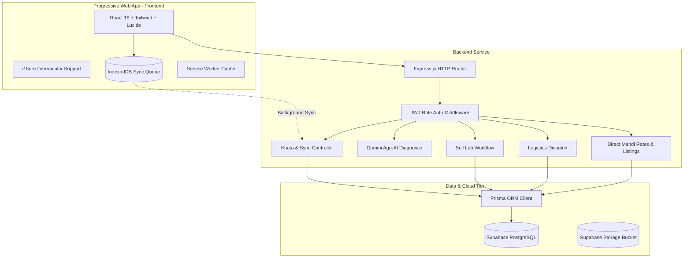

# Krishimitara / KisanSetu — Architecture Documentation

## 1. System Vision
**Krishimitara** is an offline-first, vernacular-enabled digital ecosystem designed to unify the fragmented Indian agricultural lifecycle across six core stakeholder groups:
1. Farmers
2. Soil & Agricultural Labs
3. Rural Logistics & Transport Providers
4. Government & Research Institutions
5. Agrochemical / Seed Companies
6. Sponsors & NGOs

---

## 2. Key Architectural Tenets

### A. Offline-First Sync Architecture
- **In-Field Reality**: Rural 4G/5G connections drop frequently during field work.
- **Client Queue**: Every income/expense transaction written to the farmer's **Khata Book** is first recorded with a UUID `clientSyncId` in local storage / IndexedDB.
- **Bi-directional Reconciliation**: When internet connectivity resumes, the PWA automatically flushes the queue to `POST /api/khata/sync`, ensuring zero data loss and conflict-free idempotency.

### B. Vernacular & Voice Interaction
- Designed with low-text, visual cues, high-contrast typography, and full Hindi / Regional translations.
- AI crop diagnosis provides plain-language instructions with chemical dosage and organic alternatives.

### C. Unified Stakeholder Directory
- Eliminates predatory middleman markups by connecting farmers directly with certified labs and local transport operators.
- Provides real-time APMC Mandi rates across key commodities (Wheat, Basmati, Soybean, Mustard, Cotton, Onion).
