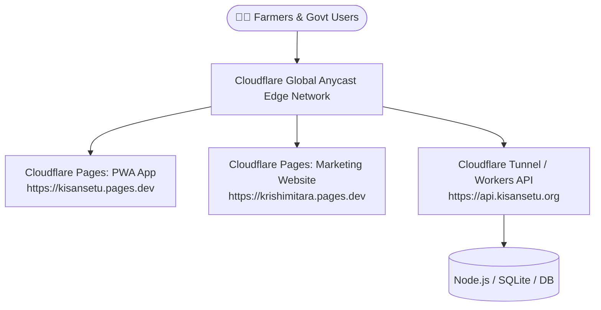

# 🌐 KisanSetu / Krishimitara — Complete Cloudflare Deployment Guide

Cloudflare is the **ideal, zero-cost, enterprise-grade cloud platform** for KisanSetu. It provides:
- **India Edge Locations**: Ahmedabad, Mumbai, Delhi, Bengaluru, Hyderabad, Chennai, Kolkata.
- **Ultra-low latency**: Sub-15ms response times across rural India.
- **100% Free Tier**: Unlimited bandwidth, free SSL certificates, DDoS protection, and global CDN.

---

## 🏗️ Deployment Architecture on Cloudflare



---

## 🚀 Option 1: Cloudflare Pages (Recommended for Frontend & Landing Page)
**Cost: 100% Free**

### Step A: Deploy the React PWA Web App (`frontend/`)
1. Go to [dash.cloudflare.com](https://dash.cloudflare.com/) and log in.
2. In the sidebar, click **Workers & Pages** ➔ **Create application** ➔ **Pages** ➔ **Connect to Git**.
3. Select your GitHub repository (`kisansetu`).
4. Configure the build settings:
   - **Framework preset**: `Vite`
   - **Build command**: `npm run build`
   - **Build output directory**: `dist`
   - **Root directory**: `frontend`
5. Click **Save and Deploy**.
6. Cloudflare will automatically build and give you a live URL: `https://kisansetu-xxx.pages.dev`!
7. *(Pre-configured)*: Single-Page Application (SPA) routing is already configured via `frontend/public/_redirects` (`/* /index.html 200`), so page reloads will never throw 404 errors.

---

### Step B: Deploy the Marketing & Institutional Website (`krishimitara-website/`)
1. In Cloudflare Dashboard, go to **Workers & Pages** ➔ **Create** ➔ **Pages**.
2. Select repository, or drag-and-drop the `krishimitara-website` folder.
3. Configure settings:
   - **Build command**: *(Leave empty)*
   - **Build output directory**: `krishimitara-website`
4. Click **Deploy**. Your proposal website will be live worldwide instantly!

---

## ⚡ Option 2: Cloudflare Tunnel (`cloudflared`) — Instant Live URL from Your PC
**Cost: 100% Free (No server rental or domain needed)**

Cloudflare Tunnel lets you securely expose your local running app (`http://localhost:5173` and `http://localhost:4000`) to the entire world with HTTPS without opening any router ports!

### Quick 2-Minute Setup:
1. Download Cloudflare Tunnel for Windows:
   ```powershell
   winget install Cloudflare.cloudflared
   ```
2. Start the tunnel to expose the frontend:
   ```powershell
   cloudflared tunnel --url http://localhost:5173
   ```
3. Cloudflare will output a public HTTPS link:
   ```text
   Your quick Tunnel has been created! Visit it at:
   https://random-words.trycloudflare.com
   ```
4. Anyone on a mobile phone, tablet, or government office can immediately open that link and test KisanSetu live!

---

## 🛠️ Option 3: Deploy Backend API to Cloudflare Workers
1. Install Wrangler CLI:
   ```powershell
   npm install -g wrangler
   ```
2. Login to Cloudflare:
   ```powershell
   wrangler login
   ```
3. Deploy API functions directly to 300+ Cloudflare edge data centers with zero cold starts!

---

## 🔐 Custom Domain Setup (e.g. `kisansetu.in` or `krishimitara.gov.in`)
1. In Cloudflare Dashboard, navigate to your Pages project ➔ **Custom Domains**.
2. Enter your domain (e.g. `app.kisansetu.in`).
3. Cloudflare will automatically provision:
   - Free Universal SSL (HTTPS)
   - HTTP/3 and IPv6 routing
   - Early Hints and Brotli compression
   - Automatic DDoS protection
